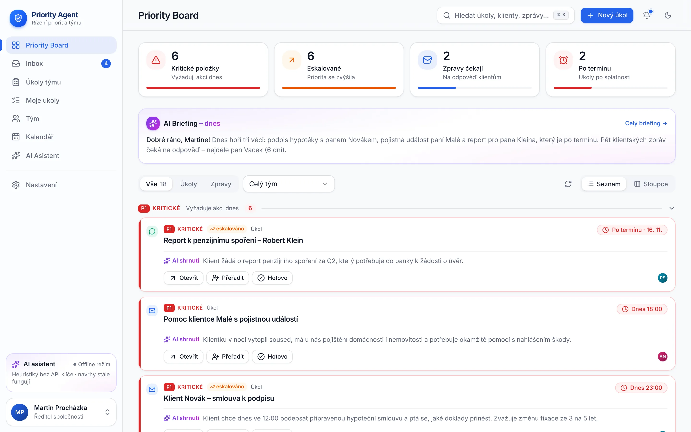
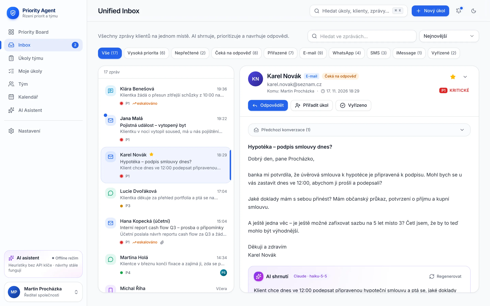
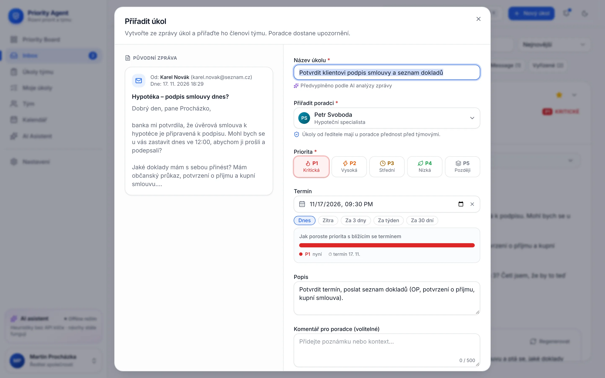
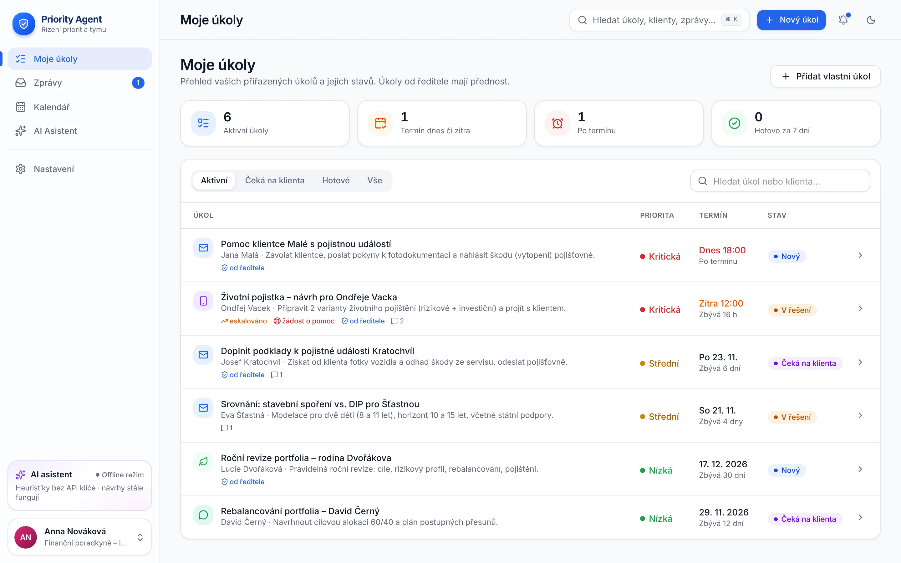
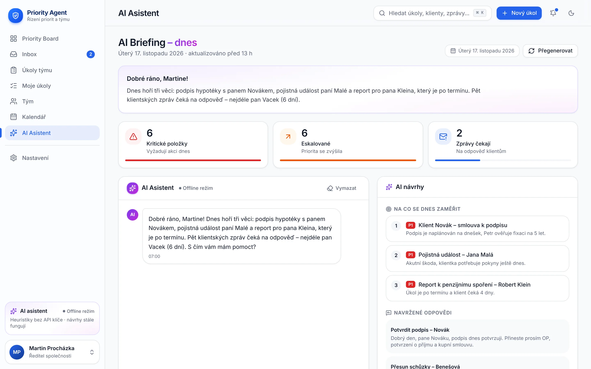
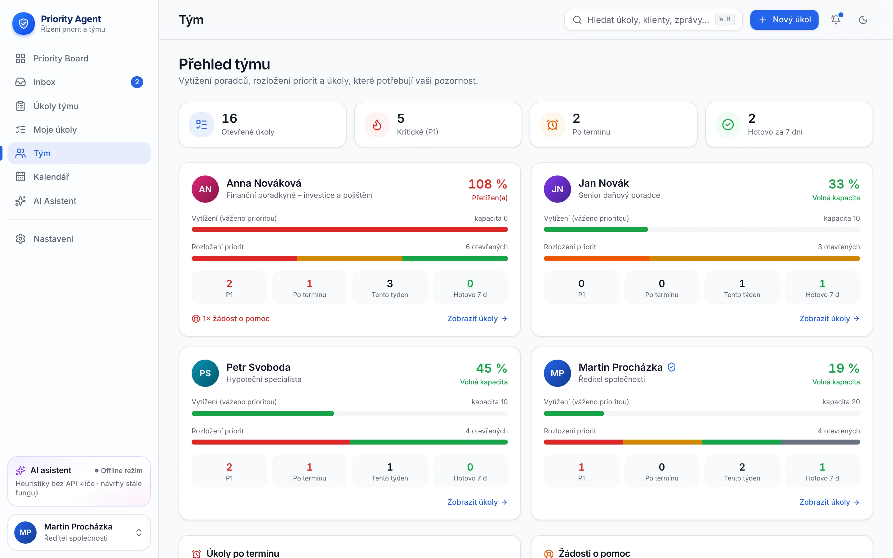
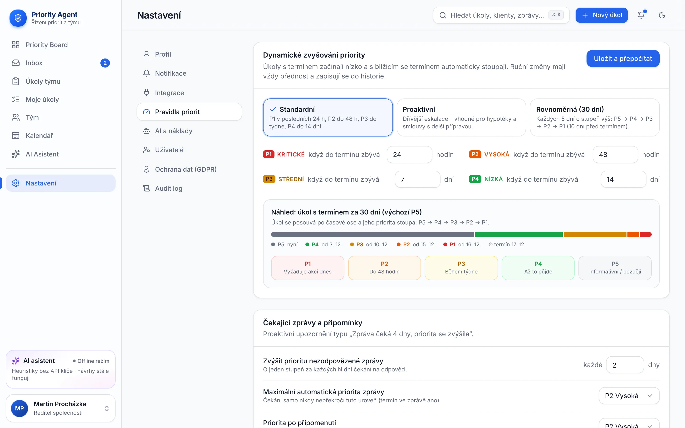

# Priority Agent

**Sjednocená komunikace, chytré priority a řízení týmu s AI asistentem** – pro ředitele finančně-poradenské firmy a jeho tým poradců.

E-maily, WhatsApp, SMS i iMessage na jednom místě. Každá zpráva dostane od AI shrnutí, prioritu P1–P5, termíny, návrhy úkolů a odpovědí. Priority se samy zvyšují, jak se blíží termín nebo jak dlouho klient čeká. Ředitel jedním kliknutím přiřadí práci poradci, poradce vidí jen své úkoly a relevantní zprávy. AI pouze navrhuje – nic neodesílá samo.



| Unified Inbox s AI shrnutím | Přiřazení úkolu poradci |
|---|---|
|  |  |
| **Moje úkoly (pohled poradce)** | **AI Briefing a asistent** |
|  |  |
| **Přehled týmu a vytížení** | **Pravidla dynamické prioritizace** |
|  |  |

---

## Obsah

1. [Funkce](#funkce)
2. [Rychlý start](#rychlý-start)
3. [Demo účty](#demo-účty)
4. [Technologie a architektura](#technologie-a-architektura)
5. [Role a oprávnění (RBAC)](#role-a-oprávnění-rbac)
6. [Priority P1–P5 a eskalace](#priority-p1p5-a-eskalace)
7. [AI agent (Claude)](#ai-agent-claude)
8. [Integrace kanálů](#integrace-kanálů)
9. [Úlohy na pozadí](#úlohy-na-pozadí)
10. [Notifikace](#notifikace)
11. [Bezpečnost a GDPR](#bezpečnost-a-gdpr)
12. [Nasazení](#nasazení)
13. [Proměnné prostředí](#proměnné-prostředí)
14. [Vývoj a testy](#vývoj-a-testy)
15. [REST API](#rest-api)

---

## Funkce

| Oblast | Co aplikace umí |
|---|---|
| **Unified Inbox** | Zprávy ze všech kanálů, ikona zdroje, odesílatel, čas, barevná priorita, AI shrnutí, stav (nepřečtená / čeká na odpověď / přiřazena / vyřízena). Filtry (kanál, priorita, stav, přiřazení), řazení, fulltext bez diakritiky, konverzační vlákno, přílohy. |
| **Detail zprávy** | Celý obsah, AI panel (shrnutí, záměr, klíčová témata, sentiment, navržená priorita s odůvodněním, termíny, navržené úkoly), 1–3 návrhy odpovědí, editor odpovědi s „Upravit s AI“, akce Odpovědět / Přiřadit úkol / Změnit prioritu / Vyřízeno, historie priority, regenerace AI. |
| **Priority Board** | Karty seřazené podle naléhavosti (seznam po úrovních P1–P5 nebo sloupce s drag & drop pro ruční změnu), AI shrnutí, termín, rychlé akce Odpovědět / Přiřadit / Hotovo, statistiky a ranní briefing. |
| **Úkoly** | Vytvoření ze zprávy i ručně, více řešitelů, termín, „připomenout za X dní“, stavy Nový → V řešení → Čeká na klienta → Hotovo, komentáře, historie priority, projekce eskalace, žádost o pomoc ředitele, export do kalendáře (.ics). |
| **Tým** | Vytížení poradců (vážené prioritou vůči kapacitě), rozložení priorit, úkoly po termínu, žádosti o pomoc. |
| **AI asistent** | Ranní briefing (na co se zaměřit, rizika, návrhy přiřazení a odpovědí), streamovaný chat nad vašimi daty, rychlé dotazy. |
| **Kalendář** | Měsíc / agenda, termíny úkolů podle priority, vlastní události, Google Kalendář a Outlook (čtení i vytváření), odběr ICS pro Apple Kalendář. |
| **Notifikace** | In-app (centrum + realtime toasty), e-mail, web push; prahy podle priority, klidové hodiny, volba událostí. |
| **Administrace** | Uživatelé a role, integrace, pravidla prioritizace, výběr AI modelu a náklady, audit log, GDPR. |
| **UX** | Light (výchozí) i dark mode, responzivní (desktop i mobil), ⌘K command palette, skeletony, mikroanimace (Motion), čeština, časové pásmo Europe/Prague. |

---

## Rychlý start

Požadavky: **Node.js 20.19+ (doporučeno 22)**, **Docker** (nebo vlastní PostgreSQL 16 + Redis 7).

```bash
git clone <repo> priority-agent && cd priority-agent
cp .env.example .env
npm run vapid            # vypíše AUTH_SECRET, ENCRYPTION_KEY, CRON_SECRET a VAPID klíče → vložte do .env
docker compose up -d     # PostgreSQL 16 (+ runtime role priority_app) a Redis 7
npm install
npm run db:deploy        # migrace (včetně Row-Level Security politik)
npm run db:seed          # demo data: ředitel, 3 poradci, administrátor, zprávy, úkoly, briefing
npm run dev              # http://localhost:3000
```

Volitelně (produkční topologie s frontou):

```bash
JOB_RUNNER=queue npm run worker     # BullMQ worker v druhém terminálu
JOB_RUNNER=queue npm run dev
```

> **AI bez klíče:** aplikace běží i bez `ANTHROPIC_API_KEY` v „offline režimu“ (heuristiky). Demo data obsahují předgenerované AI analýzy. Pro plnohodnotné AI nastavte klíč v `.env`.

> **Bez Dockeru:** stačí PostgreSQL 16 s rozšířením `pg_trgm` a spuštěný skript `docker/postgres/01-app-role.sql` (vytvoří roli `priority_app`). Redis je volitelný.

---

## Demo účty

Heslo pro všechny: **`demo1234`** (na přihlašovací stránce lze kliknout přímo na účet).

| Role | E-mail | Co uvidíte |
|---|---|---|
| Ředitel | `martin.prochazka@priority-agent.test` | Priority Board, celý inbox, úkoly týmu, tým, briefing, všechna nastavení |
| Poradkyně (investice, pojištění) | `anna.novakova@priority-agent.test` | Moje úkoly (přetížená – 100 % kapacity), relevantní zprávy |
| Daňový poradce | `jan.novak@priority-agent.test` | Moje úkoly, daňové dotazy |
| Hypoteční specialista | `petr.svoboda@priority-agent.test` | Moje úkoly včetně úkolu po termínu |
| Administrátor | `admin@priority-agent.test` | Uživatelé, integrace, AI a náklady, audit – **bez přístupu ke klientské komunikaci** |

Seed vytváří data relativně k aktuálnímu času (termíny „dnes“, „zítra“, zprávy čekající 4 a 6 dní s automaticky zvýšenou prioritou atd.), takže demo vypadá vždy aktuálně. Opakované `npm run db:seed` data obnoví.

---

## Technologie a architektura

| Vrstva | Technologie |
|---|---|
| Frontend | Next.js 16 (App Router, Turbopack), React 19, TypeScript, Tailwind CSS 4, komponenty ve stylu shadcn/ui nad Radix UI, Motion (Framer Motion), TanStack Query, cmdk, sonner, lucide |
| Backend | Next.js Route Handlers (REST), Auth.js v5 (JWT), Zod |
| Databáze | PostgreSQL 16 + Prisma 7 (driver adapter `pg`), Row-Level Security, `pg_trgm` |
| Fronty a realtime | BullMQ + Redis (volitelné), Server-Sent Events, Redis pub/sub |
| AI | Anthropic Claude API – Claude Haiku 5.5 (výchozí), Sonnet 5.5, Opus 5.5 |
| E-mail / push | Nodemailer (SMTP), Web Push (VAPID) |

Podrobně viz **[docs/ARCHITECTURE.md](docs/ARCHITECTURE.md)** (diagramy, datový model, toky dat, rozhodnutí).

```
prisma/              schéma, migrace (vč. RLS), seed
src/app/             stránky (App Router) a REST API (/api/**)
src/components/      UI – design systém (ui/), layout, board, inbox, úkoly, tým, kalendář, AI, nastavení
src/hooks/           TanStack Query hooky, realtime (SSE)
src/lib/             isomorfní logika: priority, nastavení, validace, oprávnění, formátování, DTO
src/server/          server-only: db (withActor/withSystem), auth, API wrapper, služby, AI, integrace,
                     notifikace, realtime, joby
src/worker/          BullMQ worker
tests/               Vitest (priority, RBAC, heuristiky, integrace, šifrování, formátování)
docker/              init skript PostgreSQL role, entrypoint
```

---

## Role a oprávnění (RBAC)

| Oprávnění | Ředitel | Poradce | Administrátor |
|---|:-:|:-:|:-:|
| Číst všechny zprávy a úkoly týmu | ✅ | – | – |
| Vlastní úkoly a relevantní zprávy | ✅ | ✅ | – |
| Vytvářet úkoly | ✅ | ✅ (sobě) | – |
| Přiřazovat úkoly a zprávy komukoli | ✅ | – | – |
| Měnit stav / prioritu svých úkolů | ✅ | ✅ | – |
| Komentovat, žádat ředitele o pomoc | ✅ | ✅ | – |
| Přehled týmu a vytížení | ✅ | – | – |
| Pravidla prioritizace | ✅ | – | – |
| AI model a náklady | ✅ | – | ✅ |
| Uživatelé, týmové integrace, audit log | ✅ | – | ✅ |

RBAC je vynucený **ve třech vrstvách**:

1. **Databáze** – PostgreSQL Row-Level Security. Každý dotaz běží v transakci, která nastaví `app.user_id / app.team_id / app.role`; politiky v `prisma/migrations/*_rls_policies` určí viditelné řádky. Aplikace se připojuje rolí `priority_app`, která tabulky nevlastní (jinak by RLS neplatila); migrace běží vlastníkem přes `DIRECT_URL`. Bez kontextu databáze nevrátí nic (fail-closed).
2. **API** – každý endpoint ověří session (uživatel se znovu načítá z DB), oprávnění, CSRF a rate limit; služby aplikují stejné scope jako RLS.
3. **UI** – navigace, stránky i tlačítka podle role.

---

## Priority P1–P5 a eskalace

| Úroveň | Barva | Význam | Výchozí práh termínu |
|---|---|---|---|
| **P1 Kritické** | červená | vyžaduje akci dnes | ≤ 24 h |
| **P2 Vysoká** | oranžová | do 48 hodin | ≤ 48 h |
| **P3 Střední** | žlutá | během týdne | ≤ 7 dní |
| **P4 Nízká** | zelená | až to půjde | ≤ 14 dní |
| **P5 Později** | šedá | informativní | > 14 dní |

* Úkol s termínem za 30 dní začne jako P5 a postupně stoupá až na P1. Prahy nastavuje ředitel (předvolby *Standardní*, *Proaktivní*, *Rovnoměrná 30 dní* nebo vlastní) – s živým náhledem časové osy.
* Nezodpovězená zpráva stoupne o stupeň každé 2 dny (nastavitelné, strop P2) → upozornění „Zpráva od X čeká 4 dny – priorita zvýšena na P2“.
* „Připomenout za X dní“ vrátí úkol s prioritou P2.
* Ruční změna kdykoli – vždy s záznamem v historii. Zvolí-li člověk nižší naléhavost, než termín vyžaduje, automatické zvyšování se pozastaví (viditelně, lze obnovit).
* Job `priorities.recalculate` běží každých 15 minut (a přepočet proběhne i při změně termínu či pravidel).

---

## AI agent (Claude)

* **Automaticky u každé zprávy**: shrnutí (1–2 věty), záměr, klíčová témata, sentiment, navržená priorita s odůvodněním, termíny, navazující úkoly s návrhem vhodného poradce, 1–3 varianty odpovědi.
* **Ranní briefing** pro ředitele (v nastavenou hodinu, e-mailem/push dle preferencí): na co se dnes zaměřit, rizika, vytížení týmu, návrhy přiřazení a odpovědí.
* **Proaktivní upozornění** na čekající zprávy a eskalace.
* **Chat s asistentem** nad aktuálními daty uživatele (jen v rozsahu jeho oprávnění).
* **„Upravit s AI“** v editoru odpovědi (formálněji, stručněji, zdvořile odmítnout…).
* Výstupy se ukládají do DB, lze je **regenerovat**; každé volání je v `AILog` (tokeny, cena, latence) → přehled nákladů v *Nastavení → AI a náklady*.
* **AI nikdy nic neodesílá samo.**

Modely: **Claude Haiku 5.5** (výchozí – v řádu jednotek USD měsíčně), **Claude Sonnet 5.5**, **Claude Opus 5.5** – volitelné zvlášť pro analýzu zpráv a pro briefing/chat. Volání používají strukturovaný výstup (Zod schéma) a u modelů, které to podporují, serverové fallbacky při odmítnutí (`fallbacks: "default"`).

Bez `ANTHROPIC_API_KEY` (nebo při výpadku API) se automaticky použije **offline režim** – deterministické heuristiky pro češtinu (klíčová slova, extrakce termínů typu „zítra“, „do pátku“, „30. 11.“, směrování na specializaci poradce, šablony odpovědí). UI to jasně označuje.

---

## Integrace kanálů

Všechny kanály se normalizují do jednotného formátu zprávy (deduplikace podle `kanál + externí ID`).

### Gmail + Google Kalendář (OAuth)
1. Google Cloud Console → OAuth client (Web). Redirect URI: `{APP_URL}/api/integrations/google/callback` (a pro SSO přihlášení `{APP_URL}/api/auth/callback/google`).
2. Povolte Gmail API a Google Calendar API, nastavte `GOOGLE_CLIENT_ID` a `GOOGLE_CLIENT_SECRET`.
3. *Nastavení → Integrace → Gmail → Připojit účet.* Synchronizace inkrementálně (historyId) každých 10 minut; odpovědi se odesílají ve stejném vlákně.

### Outlook / Microsoft 365 (Microsoft Graph)
1. Entra ID → App registration, redirect `{APP_URL}/api/integrations/microsoft/callback`, oprávnění `Mail.Read`, `Mail.Send`, `Calendars.ReadWrite`, `offline_access`, `User.Read`.
2. Nastavte `MICROSOFT_CLIENT_ID`, `MICROSOFT_CLIENT_SECRET`, `MICROSOFT_TENANT_ID`.

### WhatsApp Business (Cloud API)
1. Meta for Developers → WhatsApp → Webhook: callback `{APP_URL}/api/webhooks/whatsapp`, verify token = `WHATSAPP_VERIFY_TOKEN`, odběr pole `messages`.
2. Nastavte `WHATSAPP_APP_SECRET` (ověření podpisu `X-Hub-Signature-256`).
3. *Nastavení → Integrace → WhatsApp*: Phone number ID, číslo a access token (uloží se šifrovaně) – pak lze z inboxu i odpovídat (v rámci 24h okna).

### SMS a iMessage (Apple Zkratky / Twilio)
* *Nastavení → Integrace → SMS a iMessage → Vytvořit webhook* zobrazí URL a osobní token.
* iPhone: Zkratky → Automatizace → „Když dostanu zprávu“ → akce *Získat obsah URL* (POST, hlavička `Authorization: Bearer <token>`, JSON `{"from","fromName","text","channel":"sms"|"imessage"}`).
* Twilio: webhook „A message comes in“ na `{APP_URL}/api/webhooks/sms?token=<token>`; s `TWILIO_*` proměnnými se odpovědi odesílají přes Twilio a ověřuje se podpis.

```bash
curl -X POST https://vase-domena.cz/api/webhooks/sms \
  -H "Authorization: Bearer <token>" -H "Content-Type: application/json" \
  -d '{"from":"+420777123456","fromName":"Jana Malá","text":"Dobrý den…","channel":"sms"}'
```

### Kalendáře
Google a Outlook kalendář se zobrazují v *Kalendáři* a lze do nich vytvářet události. Pro Apple Kalendář (a jakýkoli jiný) slouží osobní **ICS odběr** (`/api/ics/<token>`, odkaz v Nastavení → Notifikace / v Kalendáři).

---

## Úlohy na pozadí

| Job | Kdy | Účel |
|---|---|---|
| `message.analyze` | nová zpráva | AI analýza, priorita, upozornění na urgentní zprávy |
| `notification.deliver` | nová notifikace | e-mail a web push podle preferencí a klidových hodin |
| `channels.sync` | 10 min | synchronizace Gmail / Outlook |
| `priorities.recalculate` | 15 min | eskalace priorit, čekající zprávy, zmeškané termíny |
| `briefings.generate` | 15 min | ranní briefingy po nastavené hodině |
| `notifications.flush` | 15 min | doručení upozornění odložených klidovými hodinami |

Tři režimy provozu:

* **Výchozí (`JOB_RUNNER` nenastaveno)** – úlohy běží v procesu webu po odeslání odpovědi (`after()`), plánovač startuje v `instrumentation.ts`. Ideální pro jednu instanci (`npm start`, Railway, Docker).
* **Fronta (`JOB_RUNNER=queue` + `REDIS_URL`)** – BullMQ s retry a backoffem, plány vlastní worker (`npm run worker`). Škálovatelné.
* **Serverless (Vercel)** – nastavte `INTERNAL_SCHEDULER=false`; plány spouští Vercel Cron (`vercel.json`) na `/api/cron/<job>` s hlavičkou `Authorization: Bearer $CRON_SECRET`.

---

## Notifikace

* **In-app**: centrum upozornění (zvonek) + realtime toasty přes SSE.
* **E-mail**: SMTP (`SMTP_*`); bez SMTP se e-maily jen logují.
* **Web push**: VAPID klíče (`npm run vapid`), povolení v *Nastavení → Notifikace*.
* Nastavitelné: minimální priorita pro e-mail/push, klidové hodiny (doručí se po jejich skončení), typy událostí, ranní briefing e-mailem.

---

## Bezpečnost a GDPR

* RLS v databázi + RBAC v API a UI, uživatel se ověřuje proti DB u každého požadavku.
* Přihlašovací údaje integrací šifrované **AES-256-GCM** (`ENCRYPTION_KEY`), webhook tokeny ukládané jen jako hash, ověřování podpisů Meta/Twilio, podepsaný OAuth `state`.
* Rate limiting (Redis nebo in-memory) pro přihlášení, API, AI a webhooky; ochrana CSRF; bezpečnostní hlavičky (CSP, HSTS, X-Frame-Options…).
* **Audit log** přihlášení, přiřazení, změn priorit, integrací, nastavení a GDPR akcí.
* **GDPR**: export vlastních dat (JSON), výmaz/anonymizace účtu, výmaz veškeré komunikace klienta podle e-mailu/telefonu (právo být zapomenut). Administrátor spravuje systém bez přístupu ke klientské komunikaci.

---

## Nasazení

### Vercel + Neon / Supabase
1. Vytvořte databázi (PostgreSQL 16+) a jako vlastník spusťte `docker/postgres/01-app-role.sql` (změňte heslo role `priority_app`).
2. Proměnné: `DATABASE_URL` → role `priority_app` (pooled URL), `DIRECT_URL` → vlastník (direct URL), dále `AUTH_SECRET`, `ENCRYPTION_KEY`, `CRON_SECRET`, `APP_URL`, `INTERNAL_SCHEDULER=false`, volitelně `ANTHROPIC_API_KEY`, `REDIS_URL` (např. Upstash – sdílený rate limit a realtime mezi instancemi), SMTP, VAPID, OAuth.
3. Build command `npm run build`; migrace `npm run db:deploy` (např. v CI nebo jednorázově).
4. Cron úlohy definuje `vercel.json` (intervaly kratší než denní vyžadují plán Pro).

### Railway / Render / Docker
* `docker build -t priority-agent .`
* web: `docker run --env-file .env -e RUN_MIGRATIONS=true -p 3000:3000 priority-agent`
* worker: `docker run --env-file .env -e JOB_RUNNER=queue priority-agent npm run worker` (web pak také s `JOB_RUNNER=queue`)
* `docker compose --profile app up --build` spustí lokálně celou sestavu (PostgreSQL, Redis, web, worker).
* Health check: `GET /api/health`.

---

## Proměnné prostředí

Kompletní a komentovaný seznam je v [`.env.example`](.env.example). Nejdůležitější:

| Proměnná | Povinná | Popis |
|---|:-:|---|
| `APP_URL` | ✅ | Veřejná URL (OAuth callbacky, odkazy v e-mailech) |
| `AUTH_SECRET` | ✅ | Tajemství Auth.js |
| `DATABASE_URL` | ✅ | Runtime připojení (role `priority_app` → RLS) |
| `DIRECT_URL` | doporučeno | Vlastník DB pro migrace a seed |
| `ENCRYPTION_KEY` | ✅ | 32 B (base64) pro šifrování integrací |
| `ANTHROPIC_API_KEY` | – | Claude API (bez něj offline AI) |
| `AI_DEFAULT_MODEL` | – | `claude-haiku-5-5` / `claude-sonnet-5-5` / `claude-opus-5-5` |
| `REDIS_URL` | – | Fronty, sdílený rate limit, realtime mezi instancemi |
| `JOB_RUNNER` | – | `queue` = BullMQ worker, jinak in-process |
| `INTERNAL_SCHEDULER` | – | `false` na serverless (použijte cron) |
| `CRON_SECRET` | ✅ pro cron | Ochrana `/api/cron/*` |
| `SMTP_*` | – | Odesílání e-mailových notifikací |
| `NEXT_PUBLIC_VAPID_PUBLIC_KEY`, `VAPID_PRIVATE_KEY` | – | Web push |
| `GOOGLE_*`, `MICROSOFT_*` | – | Gmail/Outlook + kalendáře + SSO |
| `WHATSAPP_*`, `TWILIO_*` | – | WhatsApp Business a SMS |
| `DEMO_MODE` | – | Zobrazit demo účty na přihlášení |

---

## Vývoj a testy

```bash
npm run dev          # vývojový server
npm run worker       # BullMQ worker (JOB_RUNNER=queue)
npm run typecheck    # TypeScript
npm run lint         # ESLint (flat config, eslint-config-next)
npm test             # Vitest – priority, RBAC, heuristiky, webhooky, šifrování, formátování
npm run build        # produkční build
npm run db:migrate   # nová migrace ze změn schématu
npm run db:reset     # reset DB + seed
npm run db:studio    # Prisma Studio (připojte se přes DIRECT_URL)
```

Konvence (viz také [`AGENTS.md`](AGENTS.md)): každý dotaz na business data běží ve `withActor`/`withSystem`; síťová volání (AI, API poskytovatelů) mimo transakci; vedlejší efekty (notifikace, realtime, joby) až po commitu přes `fx.add()`.

---

## REST API

Všechny endpointy vracejí JSON, vyžadují session cookie (kromě webhooků, cronu, ICS a health) a chyby ve tvaru `{ "error": { "code", "message", "details?" } }`.

| Metoda | Cesta | Popis |
|---|---|---|
| GET | `/api/board` | Priority Board (úkoly + čekající zprávy, statistiky) |
| GET | `/api/messages` | Seznam zpráv (`view`, `channel`, `q`, `sort`, `cursor`) + počty |
| GET / PATCH | `/api/messages/:id` | Detail / změna stavu, priority, hvězdičky, přiřazení |
| POST | `/api/messages/:id/reply` | Odeslat (nebo zaznamenat) odpověď |
| POST | `/api/messages/:id/assign` | Vytvořit úkol ze zprávy a přiřadit poradci |
| POST | `/api/messages/:id/analyze` | Regenerovat AI analýzu |
| POST | `/api/messages/:id/draft` | AI návrh / úprava odpovědi |
| GET / POST | `/api/tasks` | Seznam (`scope`, `status`, `assigneeId`, `maxPriority`, `q`…) / vytvoření |
| GET / PATCH / DELETE | `/api/tasks/:id` | Detail / úprava (stav, priorita, termín, řešitelé) / smazání |
| POST | `/api/tasks/:id/comments` | Komentář |
| POST | `/api/tasks/:id/escalate` | Žádost poradce o pomoc ředitele |
| GET | `/api/team`, `/api/team/members` | Vytížení týmu / členové |
| GET / POST | `/api/notifications` | Upozornění / označit přečtené |
| POST / DELETE | `/api/notifications/push` | Web push odběr |
| GET | `/api/search?q=` | Globální hledání |
| GET / POST | `/api/calendar`, DELETE `/api/calendar/:id` | Kalendář (vč. Google/Outlook) |
| GET / POST | `/api/ai/briefing` | Dnešní briefing / přegenerovat |
| GET / POST / DELETE | `/api/ai/chat` | Historie / streamovaná odpověď / vymazat |
| GET / PUT / PATCH | `/api/settings/*` | Tým, pravidla, AI, profil, notifikace, ICS, náklady AI |
| GET / POST / PATCH | `/api/users`, `/api/users/:id` | Správa uživatelů |
| … | `/api/integrations/*` | Seznam, SMS token, WhatsApp, OAuth connect/callback, sync, odpojení |
| GET / POST | `/api/webhooks/whatsapp`, POST `/api/webhooks/sms` | Příchozí zprávy |
| GET | `/api/cron/:job` | Spuštění plánované úlohy (Bearer `CRON_SECRET`) |
| GET | `/api/realtime` | SSE stream událostí |
| GET | `/api/ics/:token` | ICS odběr kalendáře |
| GET / DELETE / POST | `/api/gdpr/export`, `/api/gdpr/account`, `/api/gdpr/erase-contact` | GDPR |
| GET | `/api/audit` | Audit log |
| GET | `/api/health` | Stav aplikace (DB, Redis, režim jobů, AI) |
