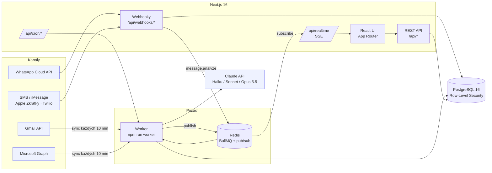
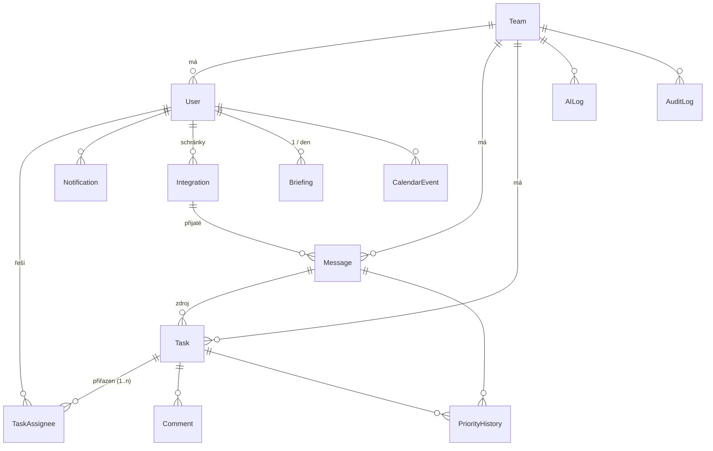

# Architektura Priority Agent

Tento dokument popisuje, jak je aplikace poskládaná, proč jsou klíčová rozhodnutí taková, jaká jsou, a kde v kódu hledat.

## Přehled

* **Jedna Next.js aplikace** obsluhuje UI, REST API, webhooky, OAuth callbacky, SSE a cron endpointy.
* **Worker** (`src/worker/index.ts`) zpracovává fronty BullMQ a vlastní opakované plány. Bez Redis běží stejné úlohy v procesu webu (`after()` + plánovač v `instrumentation.ts`) nebo přes Vercel Cron.
* **PostgreSQL** je jediný zdroj pravdy; Redis je volitelný (fronty, sdílený rate-limit, realtime fan-out).

## Vrstvy kódu

| Vrstva | Umístění | Popis |
|---|---|---|
| Isomorfní logika | `src/lib/` | Priority (`priority.ts`), nastavení a zod schémata (`settings.ts`, `validation.ts`), oprávnění (`permissions.ts`), formátování dat v Europe/Prague (`format.ts`), DTO typy. Bez závislosti na serveru – používá UI i server. |
| Server-only | `src/server/` | DB kontext (`db.ts`), auth/session, API wrapper, služby, AI, integrace, notifikace, realtime, joby. |
| Služby | `src/server/services/` | Doménová logika (úkoly, zprávy, board, tým, kalendář, nastavení, GDPR, eskalace). Všechny přijímají `db` a `user` a aplikují RBAC scope. |
| Route handlery | `src/app/api/**/route.ts` | Tenké – validace (zod) → `withActor` → služba → audit. |
| UI | `src/app/(app)/**`, `src/components/**` | Serverové stránky jen ověří oprávnění a vykreslí klientský pohled; data přes TanStack Query + SSE invalidace. |

## RBAC ve třech vrstvách

1. **Databáze – PostgreSQL Row-Level Security** (`prisma/migrations/*_rls_policies`).
   * Každý dotaz běží v krátké transakci (`withActor`), která nastaví `app.user_id`, `app.team_id`, `app.role` (`set_config(..., true)` – platí jen v transakci, bezpečné i s PgBouncerem v transakčním režimu).
   * Politiky: ředitel vidí celý tým; poradce vidí zprávy ze své schránky, sobě přiřazené a ty, ze kterých vznikl jeho úkol, a úkoly, které vytvořil nebo řeší; administrátor nevidí klientskou komunikaci vůbec.
   * Systémové úlohy používají `withSystem` (`app.bypass_rls = on`).
   * Aplikace se připojuje rolí `priority_app`, která tabulky nevlastní – proto se RLS uplatní (vlastník tabulek RLS obchází). Migrace běží vlastníkem (`DIRECT_URL`).
   * Rekurzi mezi politikami (Task ⇄ TaskAssignee ⇄ Message) řeší `SECURITY DEFINER` pomocné funkce.
2. **API** – `apiRoute()` ověří přihlášení (uživatel se při každém požadavku znovu načte z DB → deaktivace a změna role platí okamžitě), oprávnění (`can(role, permission)`), CSRF (Origin/Sec-Fetch-Site), rate limit. Služby navíc aplikují stejné scope jako RLS (`services/scopes.ts`), takže API je korektní i při připojení rolí, která RLS obchází.
3. **UI** – navigace, akce a stránky se zobrazují podle `can()`; serverové stránky volají `requirePermission()`.

## Datový model (zkráceně)

* Priority jsou `Int 1..5` (1 = P1). `basePriority` = rozhodnutí člověka nebo AI, `priority` = efektivní hodnota po eskalaci. CHECK constrainty hlídají rozsah.
* `searchText` = normalizovaný text bez diakritiky s GIN `pg_trgm` indexem → fulltext typu „novak“ najde „Novák“.
* Přihlašovací údaje integrací jsou v `Integration.credentials` šifrované AES-256-GCM (`server/crypto.ts`); webhook tokeny jsou uložené jen jako SHA-256 hash pro routování.

## Dynamická prioritizace

Čistá funkce v `src/lib/priority.ts` (pokrytá testy):

* **Úkol**: efektivní priorita = nejnaléhavější z (`basePriority`, priorita podle zbývajícího času, připomenutí). Výchozí prahy: P1 ≤ 24 h, P2 ≤ 48 h, P3 ≤ 7 dní, P4 ≤ 14 dní, jinak P5. Ředitel je mění v Nastavení (předvolby Standardní / Proaktivní / Rovnoměrná 30 dní).
* **Zpráva**: nezodpovězená příchozí zpráva stoupne o stupeň každých N dní čekání (strop P2), termín vytažený AI eskaluje jako u úkolu.
* **Ruční změna**: vždy se zapíše do historie. Pokud člověk zvolí nižší naléhavost, než termín vyžaduje, automatické zvyšování se pozastaví (viditelně v UI, lze obnovit).
* **Job `priorities.recalculate`** (každých 15 min) jen zvyšuje naléhavost; aktualizace je podmíněná původní hodnotou (optimistická souběžnost), takže paralelní běhy nikdy nezdvojí historii ani notifikace. Úkoly po termínu notifikuje jednou (`overdueNotifiedAt`).

## AI agent

| Funkce | Kód | Model (výchozí) |
|---|---|---|
| Analýza každé nové zprávy (shrnutí, záměr, témata, sentiment, priorita, termíny, úkoly + návrh poradce, 1–3 odpovědi) | `server/ai/analyze-message.ts` | Claude Haiku 5.5, `effort: low` |
| Ranní briefing (fokus, rizika, poznámky k týmu, návrhy přiřazení a odpovědí) | `server/ai/briefing.ts` | Claude Haiku 5.5, `effort: medium` |
| Chat s asistentem (streaming) | `server/ai/chat.ts` | Claude Haiku 5.5, `effort: low` |
| Úprava návrhu odpovědi podle pokynu | `server/ai/draft-reply.ts` | model analýzy |

* Volání jdou přes `client.beta.messages.parse/stream` se **strukturovaným výstupem** (Zod → JSON schema) a **server-side refusal fallbacks** (`fallbacks: "default"`). Model lze přepnout na Sonnet 5.5 / Opus 5.5 v Nastavení → AI.
* Systémové prompty jsou stabilní pro tým (kontext firmy, tón, podpis, seznam členů) → cacheovatelný prefix; data jdou do user zprávy.
* Obsah zpráv je označený jako nedůvěryhodný (ochrana proti prompt injection). Asistent dostává jen data, ke kterým má uživatel přístup (snapshot se načítá přes `withActor`).
* **AI nic neodesílá** – odpovědi odesílá vždy člověk tlačítkem.
* Každé volání se zapisuje do `AILog` (tokeny, cena, latence, chyby) → přehled nákladů v Nastavení → AI.
* **Offline režim**: bez `ANTHROPIC_API_KEY` (nebo při výpadku API) běží deterministické heuristiky (`server/ai/heuristics.ts`) – české klíčové slovníky, extrakce termínů („zítra“, „do pátku“, „30. 11.“), směrování dotazu na specializaci poradce, šablony odpovědí.

## Integrace kanálů

Vše se normalizuje do `NormalizedMessage` (`server/integrations/types.ts`) a ukládá přes `ingestMessages` (idempotentně – unikátní `teamId + channel + externalId`).

| Kanál | Příjem | Odpověď |
|---|---|---|
| Gmail | OAuth 2.0 → `history.list` (incrementálně dle `historyId`) | `users.messages.send` ve stejném vlákně |
| Outlook (Microsoft 365) | OAuth 2.0 → Graph `mailFolders/inbox/messages` od posledního času | Graph `/messages/{id}/reply` |
| WhatsApp Business | Webhook s ověřením `X-Hub-Signature-256` | Cloud API `/{phone-number-id}/messages` |
| SMS / iMessage | Webhook s Bearer tokenem (Apple Zkratky) nebo Twilio (ověření `X-Twilio-Signature`) | Twilio (je-li nastaveno), jinak „uložit a zkopírovat“ |
| Kalendář | Google Calendar / Outlook (čtení + vytváření), ICS odběr pro Apple Kalendář | – |

OAuth `state` je podepsaný HMAC, vázaný na uživatele a nonce v httpOnly cookie.

## Úlohy na pozadí

| Job | Spouštění | Co dělá |
|---|---|---|
| `message.analyze` | při příjmu zprávy | AI analýza + aplikace priority + upozornění na urgentní zprávy |
| `notification.deliver` | při vytvoření notifikace | e-mail / web push podle preferencí, klidové hodiny |
| `integration.sync` | po připojení / tlačítkem | synchronizace jedné schránky |
| `channels.sync` | každých 10 min | synchronizace všech schránek |
| `priorities.recalculate` | každých 15 min | eskalace priorit, upozornění na čekající zprávy a zmeškané termíny |
| `briefings.generate` | každých 15 min | ranní briefing ředitelům po nastavené hodině |
| `notifications.flush` | každých 15 min | doručení upozornění odložených klidovými hodinami |

Režimy: `JOB_RUNNER=queue` (BullMQ + worker, retry s exponenciálním backoffem) nebo výchozí `inline` (v procesu webu) + plánovač v `instrumentation.ts` / Vercel Cron (`vercel.json`, `/api/cron/[job]` chráněné `CRON_SECRET`).

## Realtime

`publish()` (`server/realtime.ts`) posílá události do Redis kanálu (nebo lokálního EventEmitteru). `/api/realtime` je SSE stream; události nesou jen ID/titulky a filtrují se podle týmu a příjemce. Klient (`hooks/use-realtime.ts`) invaliduje TanStack Query cache a zobrazí toast – data se vždy znovu načtou přes RBAC chráněné API. Při výpadku se EventSource sám připojí znovu (exponenciální backoff) a dotazy mají i periodický refetch.

## Bezpečnost

* Hesla bcrypt (cost 12 pro nové), rate limit přihlášení (IP i e-mail), audit neúspěšných pokusů, konstantní čas i pro neexistující účty.
* SSO (Google, Microsoft Entra ID) jen pro uživatele, které založil administrátor.
* CSP, HSTS, X-Frame-Options, Referrer-Policy, Permissions-Policy (`next.config.ts`).
* CSRF ochrana mutací (Origin / Sec-Fetch-Site) nad rámec SameSite cookies.
* Šifrování integrací AES-256-GCM, podpisy webhooků (Meta, Twilio), tokeny jen jako hash.
* Audit log (`AuditLog`) pro přihlášení, přiřazení, změny priorit, integrace, nastavení, GDPR akce.
* GDPR: export osobních dat (JSON), výmaz/anonymizace účtu, výmaz veškeré komunikace klienta (právo být zapomenut).
